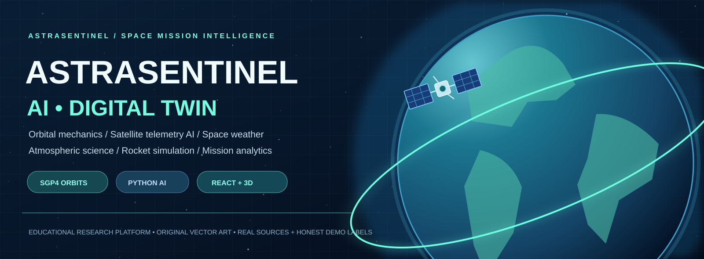
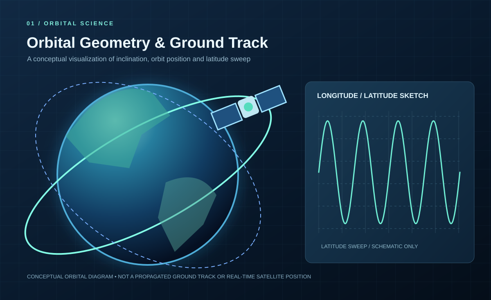
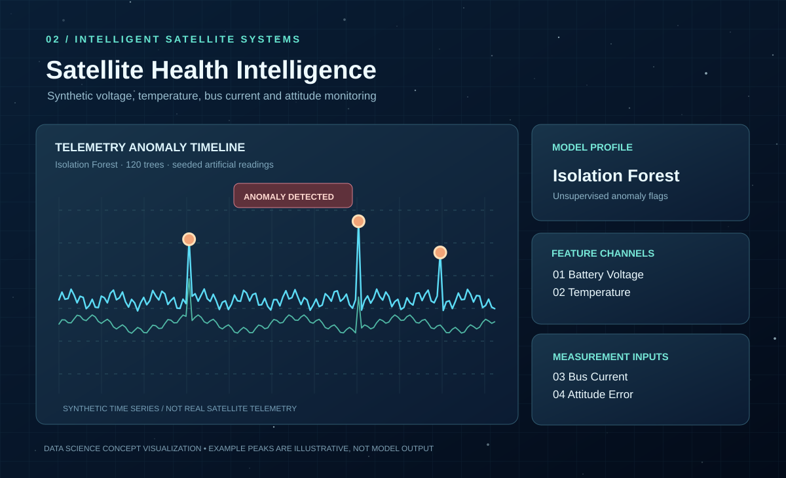
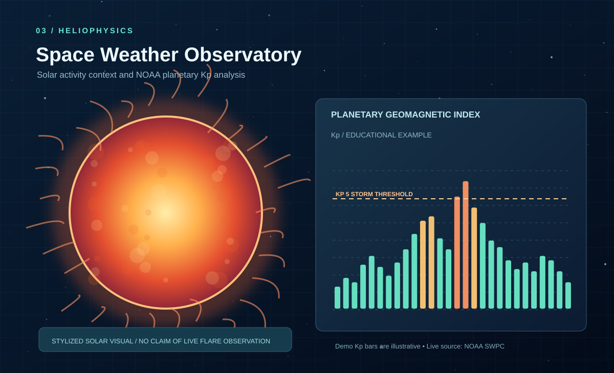
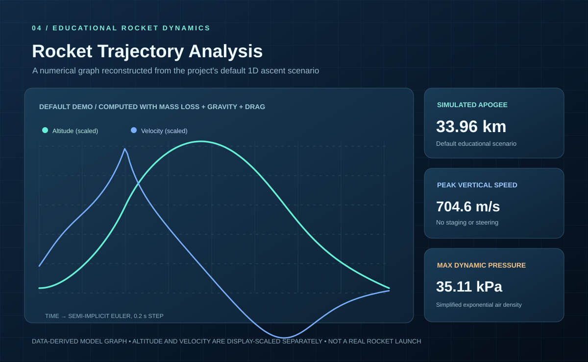
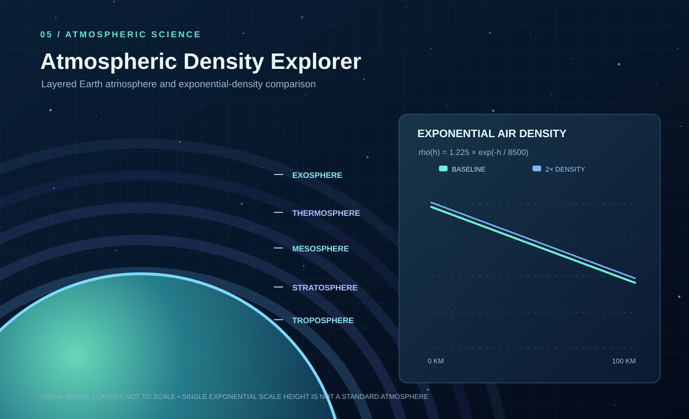
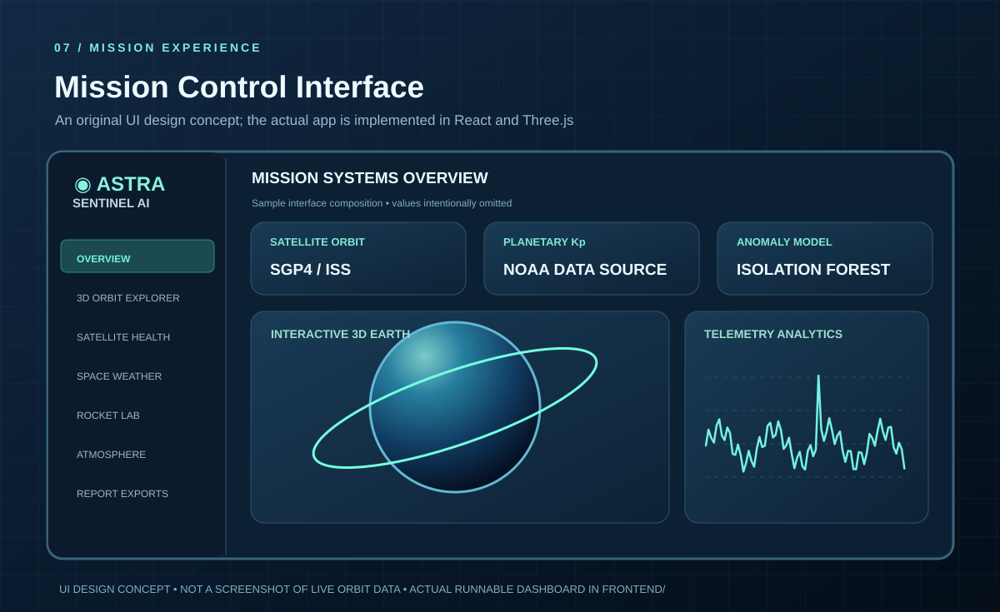

# 🛰️ AstraSentinel AI

### 3D Space Mission Digital Twin · Satellite Anomaly Intelligence · Rocket Physics

**An end-to-end aerospace AI/ML portfolio project: public orbital data + public space-weather observations + seeded telemetry ML + educational rocket simulation.**

[Portfolio Website](docs/index.html) | [Visual Gallery](docs/VISUAL_GALLERY.md) | [Quick Start](#-quick-start) | [3D Diagrams](#-project-architecture) | [Project Tree](docs/PROJECT_TREE.md) | [API](docs/API_REFERENCE.md) | [Interview Guide](docs/INTERVIEW_GUIDE.md)

> **Important:** Orbital elements and geomagnetic readings are fetched from public sources when available. **All satellite health telemetry is synthetic**. The rocket and atmospheric simulators are simplified educational models, **not real-flight design tools**. The globe's geographical shapes are artistic, not a precision Earth map. No NASA, ISRO or SpaceX affiliation or private spacecraft data access is claimed.

## 🌍 Portfolio Website

The project now includes a **mobile-responsive, GitHub Pages-ready showcase**, with original diagrams, technology overview, project links and clear scientific disclaimers.

- [Website source](docs/index.html) · [Stylesheet](docs/landing.css) · [Hosting instructions](docs/DEPLOYMENT.md)
- Preview locally from the repository root: `python -m http.server 8080 --directory docs`, then open http://localhost:8080.
- To publish publicly, enable **GitHub Pages** in Settings → Pages and select branch **main**, folder **/docs**. This website is not live until hosting is enabled and verified.
- The separate interactive React/FastAPI dashboard still requires a full-stack host. GitHub Pages **cannot** run the Python backend.

## 🎨 Space Mission Visual Gallery

**Eight original, editable SVG pictures and graphs**, committed directly to this GitHub repository. Conceptual graphics are not real flight data or screenshots of an operational mission.

| 3D Orbital Science | Satellite Health AI |
|:---:|:---:|
|  |  |
| [Orbital geometry](docs/gallery/orbital-geometry.svg) | [Anomaly detection illustration](docs/gallery/satellite-health-intelligence.svg) |

| Space Weather | Rocket Trajectory Graph |
|:---:|:---:|
|  |  |
| [Sun and Kp example](docs/gallery/space-weather-observatory.svg) | [Numerical rocket simulation](docs/gallery/rocket-flight-analysis.svg) |

| Earth's Atmospheric Layers | Mission Control Design |
|:---:|:---:|
|  |  |
| [Atmospheric density](docs/gallery/atmospheric-layers.svg) | [Dashboard visual concept](docs/gallery/mission-control-ui-concept.svg) |

[**Explore all eight images, scientific graphs, and image explanations →**](docs/VISUAL_GALLERY.md)

## ✅ Implemented features

| Module | Functionality | Disclosure |
|---|---|---|
| Satellite data explorer | Fetch ISS (NORAD 25544) public CelesTrak TLE, show provenance | CelesTrak cached for two hours; offline historical demo |
| Interactive 3D orbit and ground track | SGP4 propagation, 121 samples, 3D Earth orbit and computed latitude/longitude chart with dateline breaks | Simplified TEME-to-ECEF approximation, no precision geodetic basemap |
| Space-weather observations | NOAA SWPC Kp data, timeline, storm threshold and freshness | Supports 2026 JSON shape, labeled fallback |
| Satellite Health ML | Seeded telemetry, IsolationForest, artificial fault injection, z-score diagnostics | Synthetic-only training and evaluation |
| Rocket Lab | 1D variable-mass ascent with gravity, density, thrust and drag | Educational numerical simulation |
| Rocket Scenario Comparison | Parameter sweeps comparing thrust, propellant, drag and density | Bounded reproducible experiments with chart and CSV/JSON export |
| Atmospheric Density Lab | Adjustable exponential density profile with logarithmic visualization | Simplified reference atmosphere, not empirical validation |
| Research Report Export | Download mission JSON and orbital, rocket and synthetic telemetry CSVs | Source-attributed snapshots; offline SVG/CSV/JSON generator |
| Mission dashboard | React/Vite, react-three-fiber/Three.js, Recharts, responsive styles | Served via nginx/Docker or Vite |
| API and verification | FastAPI endpoints, bounded request validation, pytest, GitHub Actions | Offline deterministic tests |

## 🪐 Dashboard screens

1. **Mission Overview** — satellite orbit status, latest Kp value, AI anomaly count, rocket metrics.
2. **Orbital Explorer** — rotate or zoom Earth, inspect SGP4 orbit points, estimated altitude and computed latitude/longitude ground track.
3. **Satellite Health AI** — inspect synthetic anomaly events, evaluated metrics and score custom hypothetical readings.
4. **Space Weather** — view NOAA Kp trends, storm threshold and actual/demo source status.
5. **Rocket Lab** — adjust thrust, propellant, mass, atmospheric multiplier and analyze trajectory plots.
6. **Scenario Comparison Lab** — vary one rocket parameter, compare simulated apogee and trajectories, export CSV and JSON.
7. **Atmospheric Density Lab** — change air-density multiplier and inspect logarithmic altitude curves.
8. **System Architecture** — trace public data, scientific models, REST API, frontend and test coverage.

## 🚀 Quick start

### Docker Compose

Requires Docker Desktop / Docker Engine with Compose.

~~~bash
git clone https://github.com/harshakavali81-collab/AstraSentinel-AI.git
cd AstraSentinel-AI
docker compose up --build
~~~

**Dashboard:** http://localhost:3000

**Swagger API:** http://localhost:8000/docs

**Backend health:** http://localhost:8000/api/health

**Private backend staging:** Use the dedicated docker-compose.private.yml file with ASTRA_OFFLINE=1 to bind the frontend only on 127.0.0.1:3000 and keep the backend private. See [deployment security guidance](docs/DEPLOYMENT.md). A trusted authenticated HTTPS edge is still required before any public deployment.

### Run directly with Python and Node.js

Requirements: Python 3.11+, Node 22+ and npm.

Terminal 1 (backend):

~~~bash
python -m venv .venv
# Windows PowerShell: .venv\Scripts\Activate.ps1
# Linux/macOS: source .venv/bin/activate
python -m pip install -e '.[dev]'
python -m uvicorn backend.main:app --reload
~~~

Terminal 2 (frontend):

~~~bash
cd frontend
npm install
npm run dev
~~~

Then open **http://localhost:5173**. Vite proxies API requests to localhost:8000.

For a **network-independent demo**, set ASTRA_OFFLINE=1 in your backend environment. Docker users can run **ASTRA_OFFLINE=1 docker compose up --build** (PowerShell: set **$env:ASTRA_OFFLINE="1"** first) to enable deterministic offline simulation. Offline orbital data are an illustrative 2024 element pair, and weather charts use *synthetic historical example values*; both are clearly labeled.

## 🧪 Run tests and production frontend build

~~~bash
python -m pip install -e '.[dev]'
python -m pytest tests -v --cov=astrasentinel --cov-report=term-missing
cd frontend
npm install
npm run build
~~~

Generate **15 deterministic artifacts** (1 JSON, 4 CSV datasets and 10 scientific SVG graphs):

~~~bash
python -m scripts.generate_demo_artifacts --output artifacts/reports
~~~

Download the generated samples from a successful [GitHub Actions workflow run](https://github.com/harshakavali81-collab/AstraSentinel-AI/actions/workflows/ci.yml) under the artifact named **astrasentinel-scientific-demo**.

The CI workflow also runs Chromium browser screenshots and functional interaction tests against the complete offline Docker app. Download the **astrasentinel-browser-e2e** artifact from a successful GitHub Actions workflow to see actual running-app images and test traces. These are separate from the conceptual SVG gallery.

The test fixture forces offline mode. GitHub Actions runs Python tests and a separate React build on every push to main and every pull request, with a **full Docker Compose smoke test** that boots the frontend and backend together and verifies working science routes. No secret API key is required.

## 🧠 Satellite anomaly model

- **Algorithm:** scikit-learn IsolationForest, 120 estimators, contamination 0.035.
- **Features:** battery voltage (V), temperature (°C), bus current (A), attitude error (°).
- **Training:** 1,800 seeded synthetic healthy records, seed 42.
- **Evaluation:** 420 independently generated observations with controlled artificial deviations.
- **Metrics:** precision, recall, false alarms and confusion matrix; computed rather than fabricated.
- **Explanation:** largest standardized input deviation. **Anomaly score is NOT a calibrated risk probability.**

See [Model Card](docs/MODEL_CARD.md).

## 🧮 Core aerospace equations

- **Orbit:** SGP4 on a general-perturbations TLE, with approximate Earth rotation for display.
- **Atmospheric density:** ρ(h) = ρ₀ exp(−h / H), with H = 8,500 m.
- **Drag:** F = −½ρ Cᴅ A v|v|.
- **Gravity:** g(h) = g₀ [Rₑ/(Rₑ+h)]².
- **Rocket:** acceleration = (thrust + drag)/mass − g(h); semi-implicit Euler time steps.

See [Physics and Numerical Methods](docs/PHYSICS.md).

## 🎨 Project architecture and illustrations

These are project-created editable **SVG vector illustrations**, not photos or screenshots from a real mission.

~~~mermaid
flowchart TD
  C[CelesTrak TLE] --> I[Validated cached ingestion]
  N[NOAA SWPC Kp] --> I
  I --> O[SGP4 orbit model]
  I --> W[Kp normalization]
  S[Seeded synthetic telemetry] --> M[Isolation Forest]
  A[Exponential atmosphere] --> R[Variable-mass rocket simulation]
  O --> API[FastAPI REST layer]
  W --> API
  M --> API
  R --> API
  API --> UI[React dashboard]
  UI --> G[Three.js 3D Earth]
  UI --> P[Recharts plots]
  T[pytest + CI] -. verifies .-> API
~~~

## 📚 Project documentation bookmarks

| Resource | What it includes |
|---|---|
| [Full Project Structure](docs/PROJECT_TREE.md) | Actual repository folder tree and responsibilities |
| [Architecture](docs/ARCHITECTURE.md) | System layers, Mermaid sequence and module boundaries |
| [Data Sources](docs/DATA_SOURCES.md) | CelesTrak, NOAA, source formatting and freshness |
| [Physics](docs/PHYSICS.md) | SGP4 frames, gravity, atmosphere, rocket integrator |
| [Model Card](docs/MODEL_CARD.md) | Training, synthetic evaluation and interpretability |
| [API Reference](docs/API_REFERENCE.md) | All REST endpoints and sample requests |
| [Demo Guide](docs/DEMO_GUIDE.md) | Installation, six-screen walkthrough |
| [Test Plan](docs/TEST_PLAN.md) | Repeatable test strategy and scientific validation gaps |
| [Limitations](docs/LIMITATIONS.md) | Data caveats, hosting and safety limitations |
| [Interview Guide](docs/INTERVIEW_GUIDE.md) | Job-project explanation and resume bullets |
| [Experiment Lab](docs/SCENARIO_LAB.md) | One-factor rocket physics comparisons, math assumptions, API and test links |
| [Deployment Guide](docs/DEPLOYMENT.md) | Static website, server deployment and security requirements |
| [Contributing](CONTRIBUTING.md) | Tests, source transparency and project standards |
| [Mission Reports](docs/REPORTING.md) | Downloadable JSON/CSV, offline graphs and CI artifacts |

## 🌐 External data acknowledgements

[CelesTrak General Perturbations Documentation](https://celestrak.org/NORAD/documentation/gp-data-formats.php) · [CelesTrak Usage Policy](https://celestrak.org/usage-policy.php) · [NOAA SWPC Kp Data](https://services.swpc.noaa.gov/products/noaa-planetary-k-index.json)

This source repository represents a **working local educational prototype**, not a deployed hosted product or professionally certified aerospace application.

**License:** [MIT](LICENSE).
