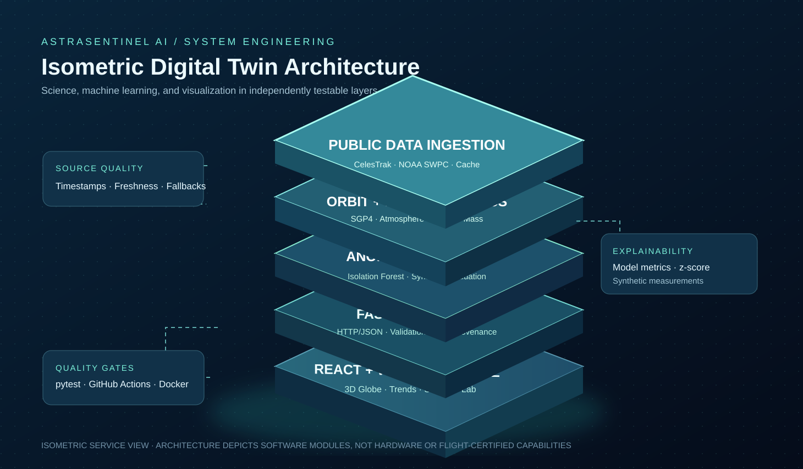
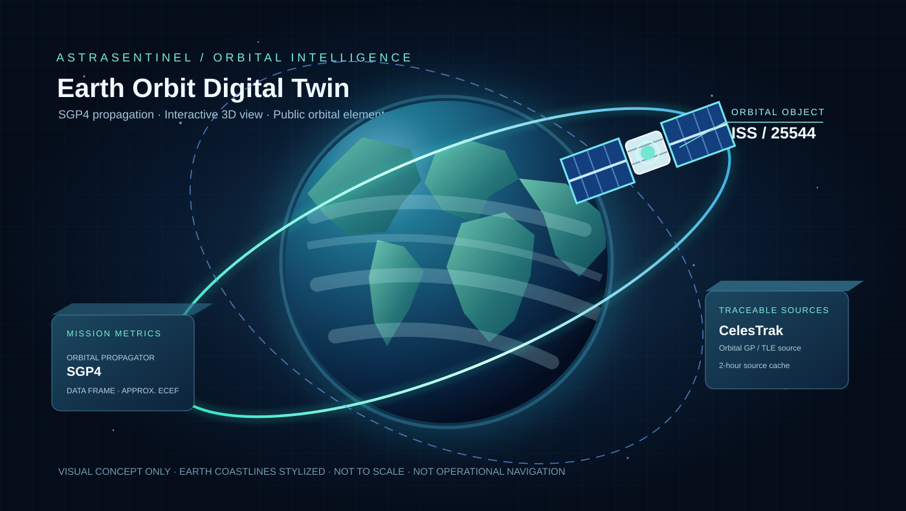

# AstraSentinel AI — Technical Architecture

[Project home](../README.md) · [Project tree](PROJECT_TREE.md) · [API reference](API_REFERENCE.md)

## Design intent

AstraSentinel v1 is a modular **educational digital twin**. It connects estimated satellite orbit state, public geomagnetic observations, **simulated** subsystem measurements, and hypothetical launch trajectories. This is not a high-fidelity physical twin of a specific active spacecraft: no proprietary sensors, onboard commands, or precise navigation messages are involved.

## End-to-end software layers

| Layer | Files | Responsibility |
|---|---|---|
| Public data ingestion | src/astrasentinel/ingestion.py | Retrieve CelesTrak ISS TLE and NOAA SWPC Kp; validate inputs, record provenance, cache requests and label fallbacks |
| Astrodynamics | src/astrasentinel/orbit.py | Propagate GP/TLE with SGP4; produce time-tagged TEME coordinates and approximate Earth-fixed positions |
| Atmospheric model | src/astrasentinel/atmosphere.py | Exponential density profile and signed aerodynamic drag |
| Rocket engine | src/astrasentinel/rocket.py | One-dimensional ascent with variable mass, thrust, gravity, drag and numerical integration |
| Machine learning | src/astrasentinel/telemetry.py | Seeded synthetic telemetry, IsolationForest training, synthetic fault injection and descriptive diagnostics |
| HTTP service | backend/main.py | FastAPI GET and POST endpoints, Pydantic input validation, errors and OpenAPI docs |
| Mission console | frontend/src/App.jsx | Section navigation, Kp timelines, anomaly chart, input forms and rocket plots |
| WebGL globe | frontend/src/OrbitGlobe.jsx | Rotatable Earth scene, 3D orbital path, sample marker and time scrubber |
| Verification | tests/ and .github/workflows/ci.yml | Deterministic offline scientific/API tests and a built frontend bundle |

## Mission data flow

~~~mermaid
flowchart TB
  C[CelesTrak GP/TLE] --> V[Validate and cache sources]
  N[NOAA SWPC Kp] --> V
  V --> O[SGP4 orbit propagation]
  V --> W[Normalized geomagnetic observations]
  S[Seeded synthetic telemetry] --> M[Isolation Forest + evaluations]
  D[Hypothetical rocket parameters] --> R[Atmosphere + Rocket Model]
  O --> B[FastAPI service]
  W --> B
  M --> B
  R --> B
  B --> F[React Mission Console]
  F --> G[WebGL 3D Globe]
  F --> P[Telemetry, Kp and rocket plots]
  T[Offline pytest + CI] -. verifies .-> B
~~~

## Request lifecycle

~~~mermaid
sequenceDiagram
  participant UI as React Dashboard
  participant API as FastAPI
  participant Data as Public Data / Cache
  participant Model as Physics / ML
  UI->>API: GET /api/orbit
  API->>Data: Query cached ISS orbital elements
  alt public data available
    Data-->>API: CelesTrak TLE + source
  else offline or invalid
    Data-->>API: Explicit 2024 demo TLE + demo label
  end
  API->>Model: SGP4 propagation / approximate ECEF
  Model-->>API: 121 sampled positions
  API-->>UI: Positions + element epoch + source freshness
  UI->>API: POST /api/rocket with chosen inputs
  API->>Model: Integrate educational ascent
  Model-->>API: Altitude, velocity, dynamic pressure
  API-->>UI: Plot-ready trajectory series
~~~

## Engineering decisions

- **Python scientific core separated from HTTP layer:** all physics and ML logic can be unit tested without running a server.
- **CelesTrak pacing:** a two-hour in-process cache avoids repeat downloads faster than documented orbital-data updates. Multi-instance hosting would require a shared/persistent cache.
- **Demo source disclosure:** offline and upstream-failure operation use clearly marked synthetic or illustrative historical examples.
- **Synthetic-only anomaly model:** deterministic training and evaluations avoid implying access to private satellite health telemetry.
- **Approximate reference-frame conversion:** adequate for a visual educational Earth globe, not accurate flight dynamics or conjunction analysis.
- **No unused infrastructure:** v1 ships a working FastAPI service and single-page application. PostgreSQL, MLflow, user management, persistent anomaly stores and mission alerting are optional future upgrades, not features we claim exist.

## Future extension points

Add a satellite catalog with OMM JSON support (newer catalog IDs can exceed TLE limits); implement rigorous Earth-orientation transformations and ground tracks; introduce permitted observational space-science datasets; validate numerical ascent against high-order reference solvers; store experiments in Postgres; version calibrated ML artifacts; add controlled user accounts and monitoring.

