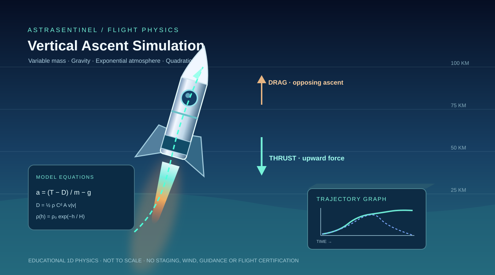

# Mission Report and Reproducible Scientific Artifacts

[Project home](../README.md) · [API](API_REFERENCE.md) · [Test Plan](TEST_PLAN.md)

## Why there are two export workflows

1. **Interactive dashboard exports:** Mission Overview includes buttons for a consolidated JSON research report plus orbital, telemetry and rocket CSV files. Orbit CSV records contain explicit source/coordinate-frame columns; telemetry CSV includes the synthetic-injection flags. The JSON report reflects the server's current source provenance. The rocket export on Mission Overview uses the **default preview scenario**, not previously adjusted inputs on a separate Rocket Lab page.
2. **Deterministic offline report generator:** A Python command builds a fully reproducible snapshot and scientific data figures using the illustrative 2024 TLE, synthetic NOAA example points, synthetic telemetry, and the educational rocket model. It does not access public data services and must never be represented as live observations.

## Generate reports and graphs

Prerequisite: install project dependencies with pip install -e '.[dev]' from the repository root.

~~~bash
python -m scripts.generate_demo_artifacts --output artifacts/reports
~~~

The command produces five files:

| Output | Contents |
|---|---|
| mission_snapshot_demo.json | Complete mission snapshot, scientific configuration, data sources, synthetic model metrics, limitations |
| orbit_track_demo.csv | Historical demo orbit positions, time and approximate Earth coordinates |
| satellite_telemetry_demo.csv | Synthetic sensor readings, injected labels, anomaly scores and explanations |
| rocket_trajectory_demo.csv | Numerical rocket altitude, velocity, acceleration, mass and dynamic pressure across time |
| rocket_ascent_demo.svg | Original data-driven vector graph of the simulated rocket altitude curve |

GitHub Actions additionally runs this command after the Python tests and uploads these files as a **30-day downloadable Actions artifact named astrasentinel-scientific-demo**. Use the [Actions tab](https://github.com/harshakavali81-collab/AstraSentinel-AI/actions/workflows/ci.yml), select a successful workflow run and open the artifact section to retrieve them. Workflow artifacts are not persisted forever; they can always be regenerated locally.

## JSON report fields

The REST route **GET /api/mission/report** gives a source-attributed report with:

- UTC creation timestamp and schema version.
- Satellite name/NORAD ID, TLE source and age, status, reference-frame explanation, period and inclination.
- NOAA planetary Kp source/status and observation age.
- Synthetic telemetry model details, flags, evaluation precision, recall and false alarm rate.
- Default illustrative rocket scenario, apogee/velocity/dynamic-pressure metrics and numerical assumptions.
- Explicit limitations forbidding operational interpretation.

Reports are **not** engineering certification or real spacecraft diagnostics.

## Reproducibility checks

The integration tests generate the offline dataset twice, compare bytes for all five outputs, verify CSV sizes and verify science-limitation disclosures. The fixed report timestamp used by the reproducible fixture is historical; the interactive API returns the current report creation timestamp.

Use report files in job portfolios with visible **SIMULATED / DEMO** labels.
