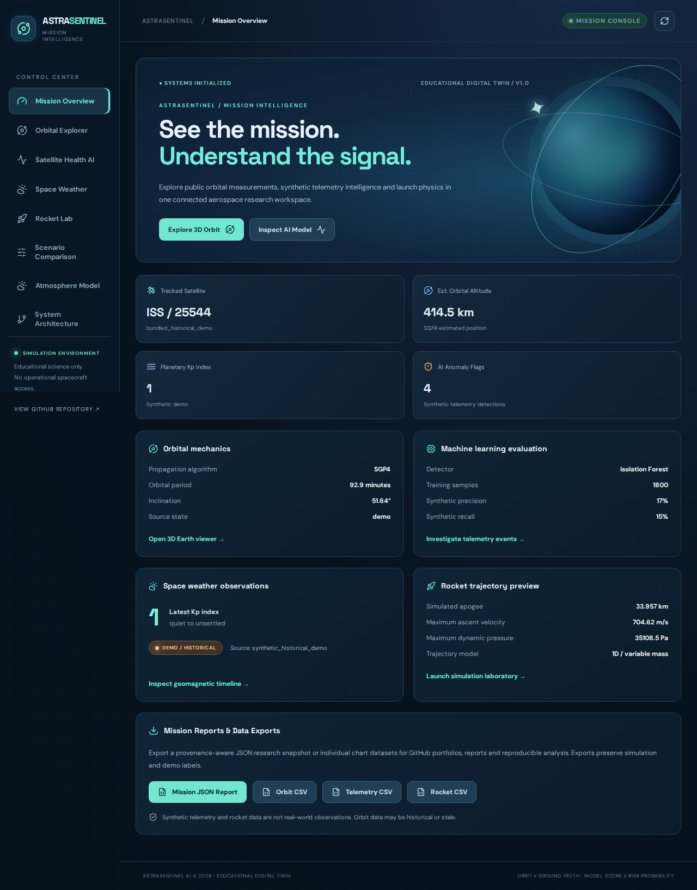
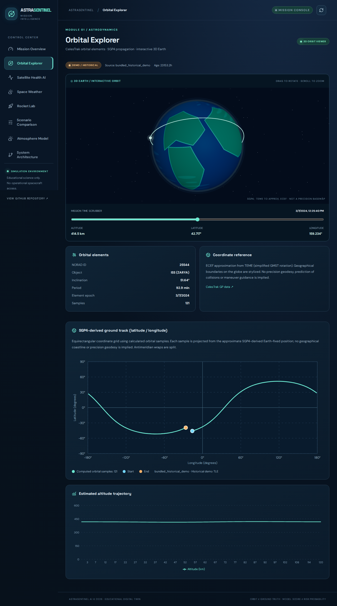
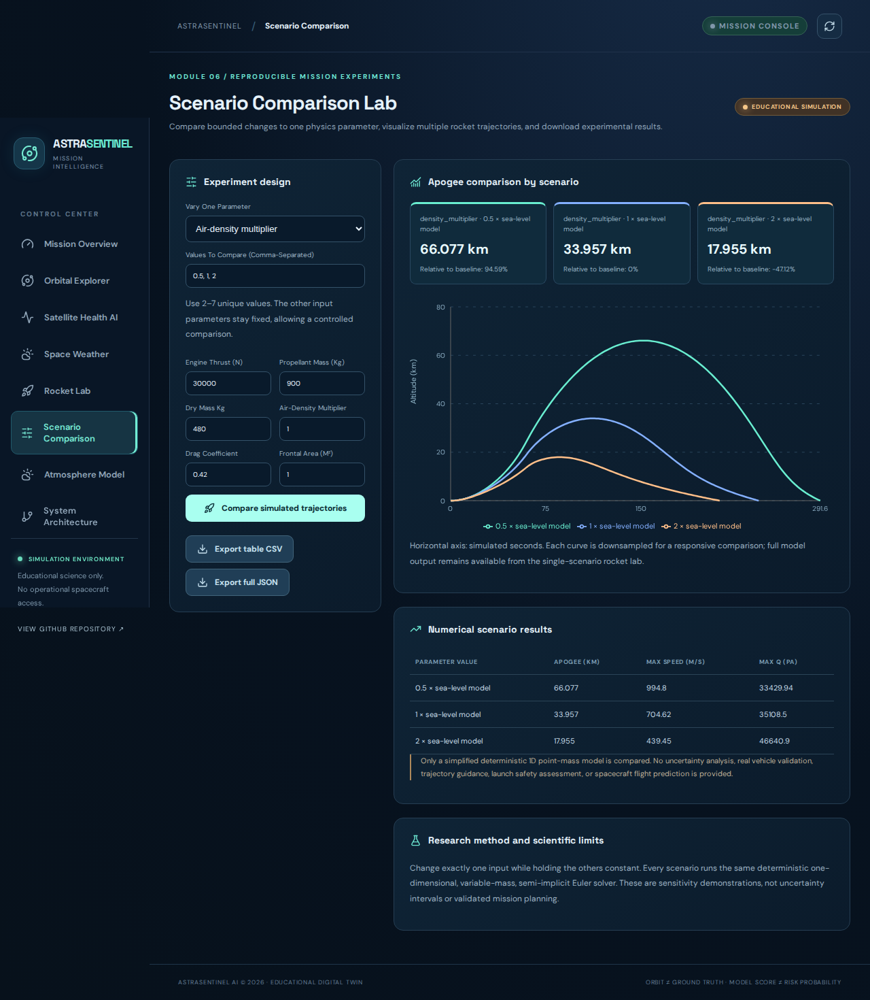
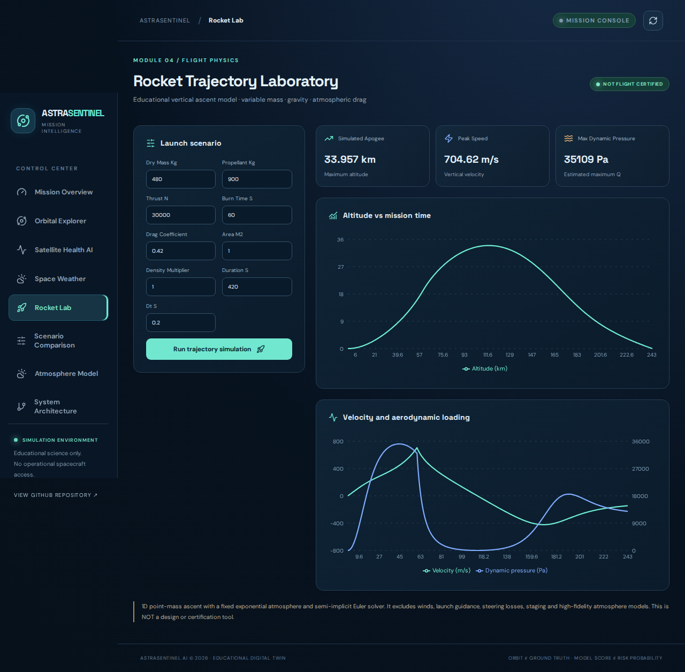
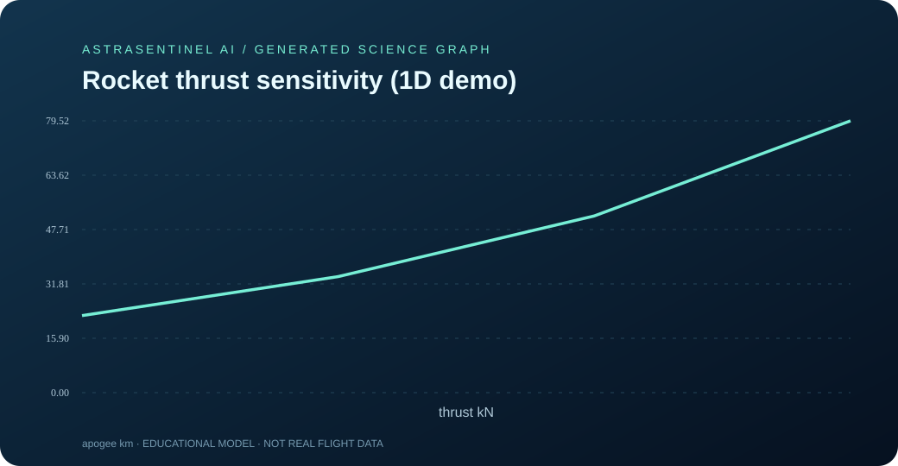
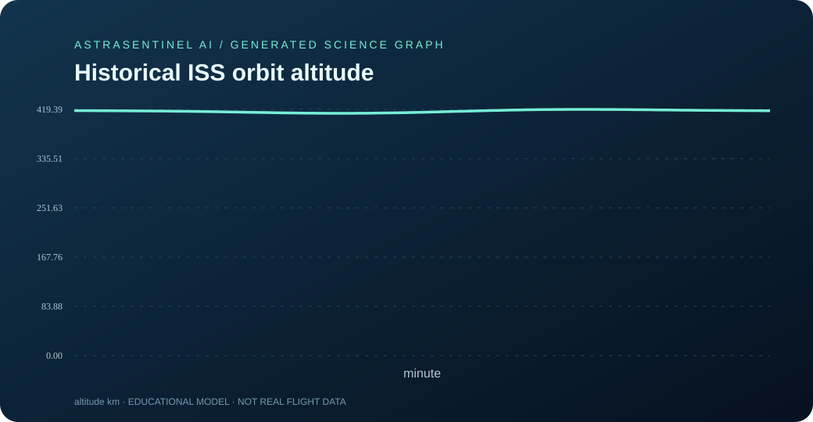
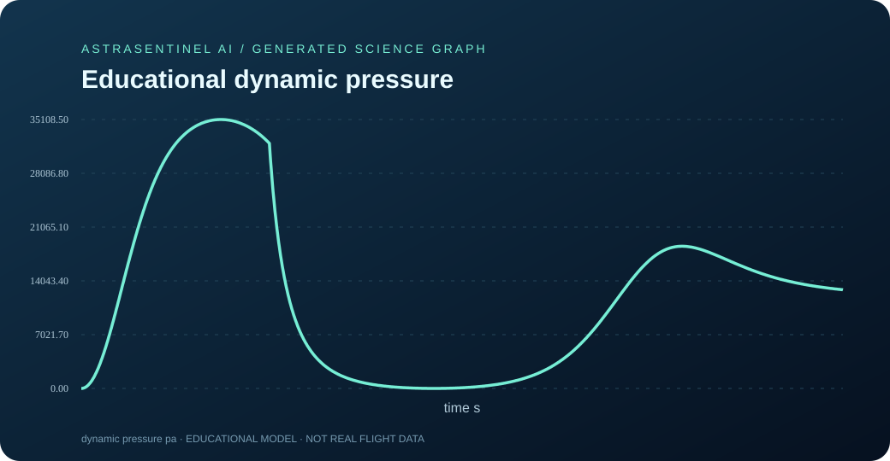
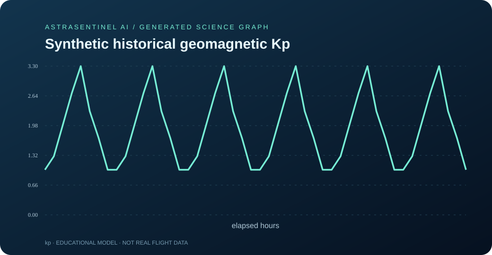
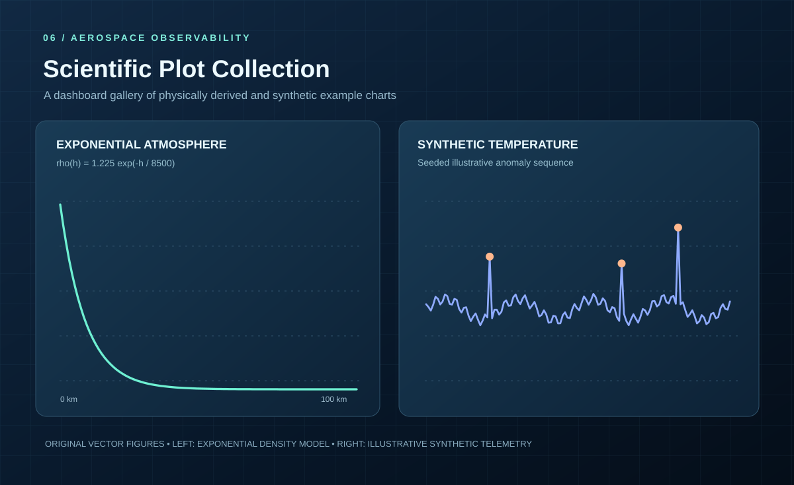

# AstraSentinel AI — Visual Gallery and Scientific Graphs

[← Project Home](../README.md) · [Architecture](ARCHITECTURE.md) · [Reports](REPORTING.md) · [Folder Tree](PROJECT_TREE.md)

Original, editable SVG illustrations developed for a polished space-AI research portfolio. Original concept illustrations live as vector source under docs/gallery/. Verified **real app screenshots** are separately stored in docs/screenshots; reproducible numerical graphs are in docs/science. None depicts operational NASA, ISRO or SpaceX spacecraft imagery.

**Scientific integrity:** Separate illustrative artwork, real app screenshots, and computed graphs. All offline scientific data use a historical bundled TLE, simplified educational physics, or synthetic weather/telemetry.

## Actual browser screenshots — verified running application

These four PNG files are captured by Playwright/Chromium from the **real React and FastAPI application** running in its offline Docker mode. Unlike the original SVG mockups below, these are genuine screen captures. The historical orbit and artificial weather/telemetry values are explicitly demonstration data.

| Real dashboard | Real SGP4 ground-track screen |
|:---:|:---:|
|  |  |

| Rocket experiment comparison | Educational rocket lab |
|:---:|:---:|
|  |  |

[View screenshot provenance and full-resolution files](screenshots/README.md).

## Real numerical scientific graphs

These SVGs are **generated by the actual Python modules**. They use deterministic historical/synthetic samples, not current NASA or NOAA measurements.

| Computed educational thrust sensitivity | Historical orbit altitude |
|:---:|:---:|
|  |  |

| Educational rocket dynamic pressure | Historical synthetic geomagnetic Kp |
|:---:|:---:|
|  |  |

[See all 15 reproducible science artifacts](science/README.md).

## Panoramic GitHub Hero

A cinematic illustration of Earth, orbital path and satellite, designed as a recognizable repository header.

## 01 — 3D Orbital Geometry

The right-side latitude sweep is **schematic**, not an SGP4-propagated ground track. The actual backend returns computed orbital samples in /api/orbit.

## 02 — Satellite Health Intelligence

The plotted peaks are artistic **synthetic example** anomalies, not real satellite observations and not numeric output from the backend ML detector.

## 03 — Solar Weather Observatory

The solar surface and the Kp bar values are illustrative. Live NOAA Kp values, when available, are fetched separately through the application.

## 04 — Rocket Flight Simulation Graph

The altitude and speed curves reproduce the default educational 1D rocket-simulator algorithm. Both are **display-scaled separately** to share a visual panel. The numeric metrics are simulated, not actual launch observations, and the plot is not flight certified.

## 05 — Earth's Atmospheric Layers

The layer bands are an artistic visual analogy rather than geophysical heights drawn to scale. The density curve reflects a single 8500-meter exponential scale-height relationship, not a validated atmosphere model.

## 06 — Data Science Graph Collection

Left: mathematical exponential-density relationship. Right: illustrative synthetic measurement spikes, not actual spacecraft measurements.

## 07 — Mission Dashboard Visual Design

Original mockup of the mission dashboard interface. This is **not a screenshot** of an actual browser session. The production-buildable React frontend lives in the frontend folder.

## More Original 3D-Style Engineering Diagrams

## Data-driven reports

Generate reproducible machine-readable simulation CSVs, JSON and an original rocket graph from the Python scientific engines:

~~~bash
python -m pip install -e '.[dev]'
python -m scripts.generate_demo_artifacts --output artifacts/reports
~~~

GitHub Actions also exposes these outputs as the downloadable artifact named astrasentinel-scientific-demo on successful workflow runs.

**Disclosure:** These SVG diagrams are original educational artwork. Do not describe them as space-agency imagery, a real solar flare observation, a measured satellite orbit map, or operational spacecraft health data.
